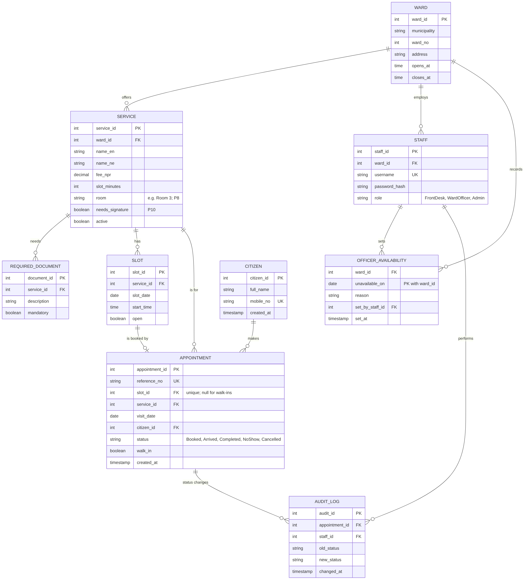

# Data Model

> **In simple words:** a map of the information the system saves. Each box is one "register" (table); lines show how they connect. Version 1.0 adds the room for each service and a register of days the signing officer is away (from interviews P8 and P10).

## Entity–relationship diagram

## Business rules enforced by the data model

| Rule | How it is enforced | Requirement |
|---|---|---|
| One booking per slot | Unique constraint on `appointment.slot_id` | FR-08 |
| One booking per citizen per service per day | Unique constraint on (`citizen_id`, `service_id`, `visit_date`) for active bookings | FR-07 |
| No slots on days the signing officer is away, for services that need a signature | Slot query excludes dates in `officer_availability` when `service.needs_signature` is true | FR-24 |
| Walk-ins have no slot | `slot_id` is nullable; `walk_in` = true | FR-16 |
| Valid status only | Check constraint on `appointment.status` | FR-15 |
| Audit records cannot be edited | No update or delete permission on `audit_log` for any application role | NFR-05 |
| Staff see own ward only | Every staff query filtered by `staff.ward_id` | NFR-04 |

---
*Diagram source (for editing): [data-model.mmd.txt](data-model.mmd.txt) — paste into [mermaid.live](https://mermaid.live), or the dbdiagram.io block in that file into [dbdiagram.io](https://dbdiagram.io), if you ever need to change it.*
