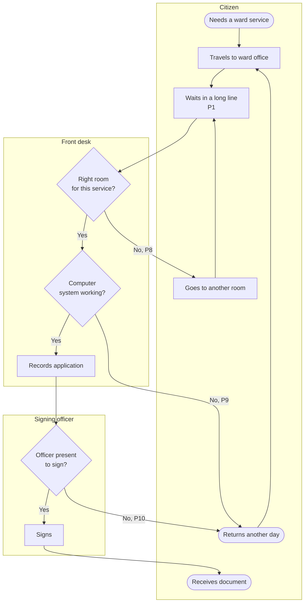
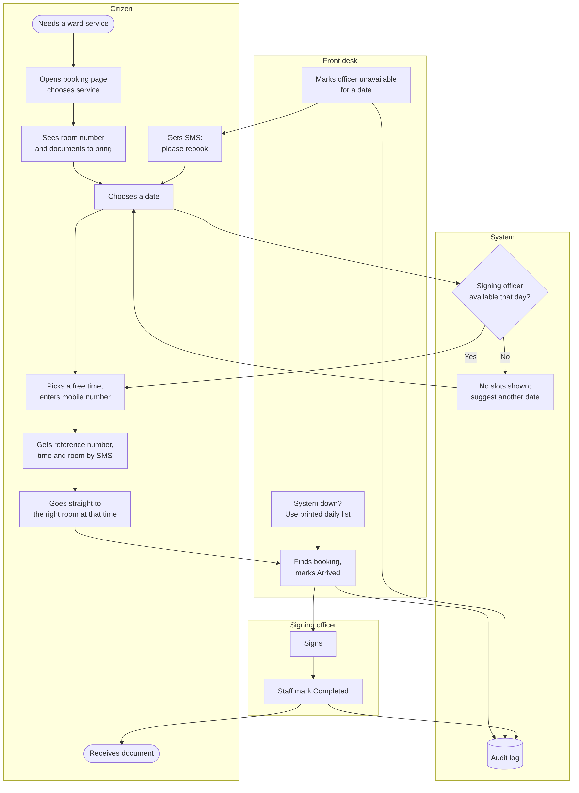

# Process Flows

> **In simple words:** two pictures. The first shows a ward visit today, including the four problems people told us about. The second shows the same visit with the new system.

## As-is: a ward visit today (from interviews)

**Where time is lost:** the line (P1), being sent to another room (P8), the system being down (P9), and the officer not being there to sign (P10). Three of the four lead to a wasted trip.

## To-be: with appointment booking

**What changes:**
- **P1 queues:** citizens come at a booked time.
- **P8 rooms:** the room is shown before they arrive.
- **P9 system down:** staff keep working from the printed list (dotted line).
- **P10 officer absent:** dates when the officer is away can't be booked, and people already booked get an SMS to rebook before they travel.

---
*Diagram source (for editing): [process-flows.mmd.txt](process-flows.mmd.txt) — paste into [mermaid.live](https://mermaid.live) if you ever need to change it.*
