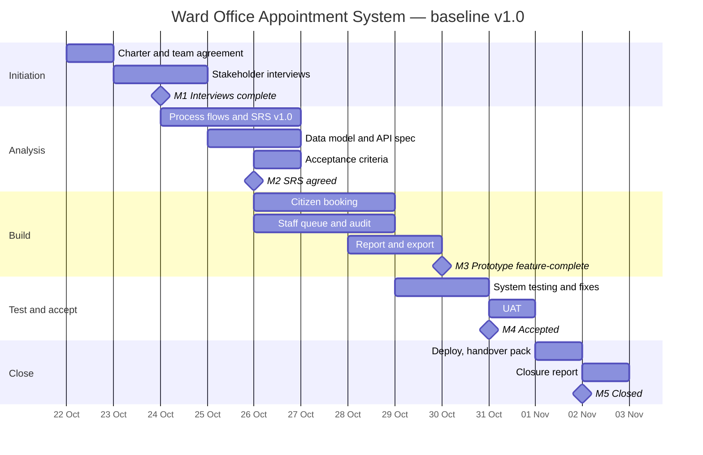

# Project Plan — Baseline v1.0

**Baselined:** 22 October 2026 · **Project manager:** Basant Tamang

Do not edit this file after baselining. Record changes in [change-log.csv](change-log.csv) and save a new plan version (v1.1, v1.2…). The closure report compares actual dates against this baseline.

## Work breakdown and estimates

Estimates use three points: (best + 4 × likely + worst) ÷ 6, in hours.

| ID | Task | Owner | Best | Likely | Worst | Estimate (h) | Depends on |
|---|---|---|---|---|---|---|---|
| 1.1 | Project charter and team agreement | Basant | 1 | 2 | 4 | 2.2 | — |
| 1.2 | Stakeholder interviews (3–5) | Basant | 3 | 5 | 8 | 5.2 | 1.1 |
| 1.3 | Interview notes and pain points | Basant | 1 | 2 | 3 | 2.0 | 1.2 |
| 2.1 | As-is and to-be process flows | Basant | 1 | 2 | 4 | 2.2 | 1.3 |
| 2.2 | SRS v1.0 | Basant | 4 | 6 | 10 | 6.3 | 1.3 |
| 2.3 | Data model | Basant | 1 | 2 | 3 | 2.0 | 2.2 |
| 2.4 | API specification | Basant | 2 | 3 | 5 | 3.2 | 2.3 |
| 2.5 | Acceptance criteria | Basant + tester | 2 | 3 | 4 | 3.0 | 2.2 |
| 3.1 | Citizen booking screens | Front-end dev | 4 | 6 | 10 | 6.3 | 2.2 |
| 3.2 | Staff queue, walk-ins and audit log | Developer | 4 | 6 | 10 | 6.3 | 2.3 |
| 3.3 | Daily report and CSV export | Developer | 2 | 3 | 5 | 3.2 | 3.2 |
| 4.1 | System testing and defect fixing | Tester + devs | 3 | 4 | 6 | 4.2 | 3.1, 3.2, 3.3 |
| 4.2 | User acceptance testing (3 users) | Tester + Basant | 2 | 3 | 5 | 3.2 | 4.1 |
| 4.3 | Traceability matrix complete | Basant | 1 | 2 | 3 | 2.0 | 4.2 |
| 5.1 | Deploy to GitHub Pages | Developer | 0.5 | 1 | 2 | 1.1 | 4.1 |
| 5.2 | Handover pack (user and admin guides) | Basant | 2 | 3 | 4 | 3.0 | 4.2 |
| 5.3 | Closure report | Basant | 1 | 2 | 3 | 2.0 | 5.2 |

**Total estimate:** about 57 hours across the team.

## Schedule

## Reporting

- Check-in every two days, 15 minutes
- Status reports issued Friday 24 Oct and Friday 31 Oct, using [status-report-template.md](status-report-template.md)
